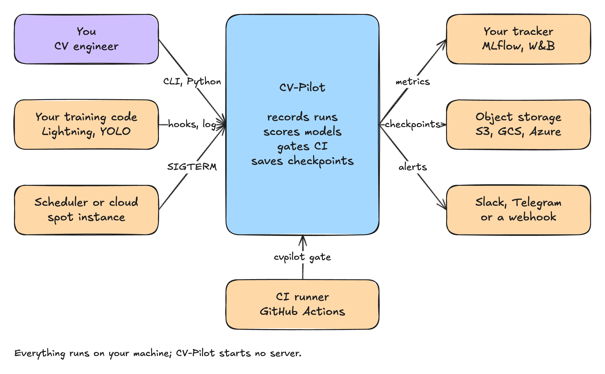
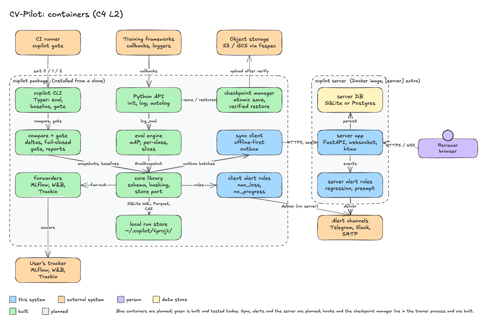

# CV-Pilot

Regression gates, remote monitoring and resume-safe checkpoints for vision models, on top of
the experiment tracker you already use.

## Status

Built and tested: run capture, the local run store, the eval engine, baselines, compare and gate,
reports, tracker forwarders, Lightning and Ultralytics hooks and a GitHub Action.

- Python API: `cvpilot.init`, `log`, `log_artifact`, `finish` (and `Run` as a context manager)
  record a run (environment, git state, dataset hash, metrics) into `~/.cvpilot/<project>/`:
  SQLite in WAL mode for run rows, batched Parquet files for metric points, a
  content-addressed directory for artifacts. A process killed with SIGKILL leaves a readable
  store; the run stays `running` until it is marked `failed`.
- Eval: `Run.log_eval(preds, gts, step=...)` and `cvpilot eval RUN_ID --preds p.parquet --gts g.parquet --classes names.txt` store an immutable snapshot (COCO-style mAP, per-class AP, confusion, slices, bootstrap intervals); see below.
- Baselines, compare and gate: `cvpilot baseline set|list|show`, `compare`, `gate`; the gate fails
  closed on anything missing, non-finite, unverifiable or incomparable; see below.
- Forwarders and hooks: `init(forward_to=[...])` and `autolog(trainer_or_model, ...)`; see below.
- CLI: `cvpilot --version`, `doctor`, `runs list`, `runs show RUN_ID`, `repro RUN_ID`, `eval RUN_ID`,
  `baseline`, `compare`, `gate`, with the exit-code contract of
  [docs/engineering/errors-and-logging.md](docs/engineering/errors-and-logging.md).
- Settings: `CVPILOT_ENV`, `CVPILOT_LOG_LEVEL`, `CVPILOT_PROJECT`, `CVPILOT_STORE_DIR`,
  `CVPILOT_STORE_COMMAND_LINE`, `CVPILOT_FORWARD_TO`; structured JSON logging on `stderr`.

Everything under "Planned usage" below is **not implemented**: no checkpoint manager, server or
alerts. The architecture documents mark each part as built or planned and describe only the
built parts as behaviour that exists. See [CHANGELOG.md](CHANGELOG.md).

## Install (from source)

Requires Python 3.10 or newer and [`uv`](https://docs.astral.sh/uv/).

```bash
git clone <repository-url> cv-pilot
cd cv-pilot
uv sync
uv run cvpilot --version
uv run cvpilot doctor
```

`doctor` prints `ok` on `stdout` and one JSON log line (`doctor_completed`) on `stderr`.
Exit codes: `0` success, `1` failure, `2` usage or configuration error, `130` interrupted.

## Record and inspect a run

```python
# train.py
import cvpilot

with cvpilot.init(task="detection", config={"lr": 0.01}, seed=0) as run:
    for step in range(3):
        cvpilot.log({"train/loss": 1.0 / (step + 1)}, step=step)
```

```bash
export CVPILOT_PROJECT=demo CVPILOT_STORE_DIR=$PWD/store   # default store: ~/.cvpilot
uv run python train.py              # logs run_started and run_finished on stderr
uv run cvpilot runs list            # RUN_ID  STATUS  STARTED  NAME
uv run cvpilot runs show <RUN_ID>   # add --json for the full record
uv run cvpilot repro <RUN_ID>       # prints a bash script: checkout, stored diff, command
```

Notes:

- `init` works outside a git repository and without a GPU: absent facts are recorded as none.
- A step must be strictly greater than the last step logged for the same metric key.
- `log` buffers up to 10 000 points and writes one Parquet file when the buffer is full or
  2 s have passed; `finish` flushes and compacts them.
- Secrets in the config and on the command line are redacted before storage (best effort for
  free text). Set `CVPILOT_STORE_COMMAND_LINE=false` to store only the executable name and
  the number of arguments; `repro` then cannot re-run the command.
- Exit codes of `runs` and `repro`: `1` for a well-formed run id that is not in the store,
  `2` for a missing project, an invalid project or a malformed run id.
- `benchmarks/log_readback.py` logs 100 000 points and reads them back;
  `benchmarks/install_size.sh` checks that the core install carries no torch.

## Evaluate predictions

Parquet files: predictions `image_id, cls, score, x1, y1, x2, y2`; ground truth `image_id, cls,
x1, y1, x2, y2` plus optional `iscrowd`, `width`, `height` and metadata columns (a row with a
null `cls` declares an image without objects); one class name per line (or a JSON list).

```bash
uv run cvpilot eval <RUN_ID> --preds p.parquet --gts g.parquet --classes names.txt \
  --slices camera=camera --step 10 --seed 0 --resamples 1000      # add --json for the snapshot
uv run cvpilot runs show <RUN_ID>                                  # lists the snapshot
uv run python benchmarks/eval_throughput.py                        # timing and peak memory
```

Exit codes of `eval`: `1` invalid inputs, a closed run (add `--allow-closed` to evaluate into a
finished run), an unknown run, a snapshot whose digest does not match, or an existing snapshot
(snapshots are immutable per set and step); `2` usage errors (bad `--slices`, a step or seed out
of range). `--max-memory-mb` caps the address space on Linux. Optional `--checkpoint-sha256` and
`--git-commit` are stored with the snapshot. Values are fractions in [0, 1].

## Baselines, compare and gate

Commands below were run against a store holding four runs of the same synthetic 40-image set
(`tests/support.py: write_eval_files`): a baseline, an equal run, a run with 10 broken
predictions and a run of a different evaluation set. Pins are append-only; `--replace` adds a
newer pin and keeps the old one.

```bash
cvpilot baseline set prod <BASELINE_RUN>        # pins the latest snapshot; --eval-set HASH, --step N
cvpilot baseline list                           # add --json, --history
cvpilot gate <RUN> --baseline tag:prod --max-drop mAP50_95=0.5 \
  --per-class-max-drop AP50_95=2.0 --slice-max-drop "camera=*:1.5" --min-images 20
cvpilot compare <RUN> --baseline tag:prod --report cmp.html --report-json cmp.json
```

```text
$ cvpilot gate <regressed run> --baseline tag:prod --max-drop mAP50_95=0.5 --per-class-max-drop AP50_95=2.0 --min-images 20
gate: FAIL (3 violations, worst: [class_drop] cat) run 01M4... step 0 vs baseline tag:prod
  - [class_drop] cat: AP50_95 of class dropped 43.56 points (limit 2)
  - [headline_drop] mAP50_95: mAP50_95 dropped 43.56 points (limit 0.5)
exit=1
$ cvpilot gate <equal run> ... --slice-max-drop "camera=*:1.5" --min-images 20
gate: PASS (5 checks, 0 slices skipped) run 01M4... step 0 vs baseline tag:prod
exit=0
$ cvpilot gate <run of another evaluation set> --baseline tag:prod ...
error: run 01M4... has no snapshot for eval set 65d37ab51abe        # event compare_refused
exit=1
```

Limits are in points on the 0..100 scale (`--max-drop mAP50_95=0.5` is 0.005 of the fraction in
the snapshot); a drop equal to the limit passes and improvements never fail. The gate fails
closed (exit 1) on an absent or non-finite metric, an absent or too small slice, fewer than
`--min-images` images (default 30), a threshold that gated nothing, a snapshot or baseline that
fails its integrity check, an unknown tag, and a different `eval_set_hash`, task, class names or
evaluation parameters; with no threshold at all it is a usage error (exit 2).
`--skip-small-slices` is the one explicit opt-in, capped by `--max-skipped` (default 0). In CI add `--recompute --gt GT --classes FILE`, `--require-commit SHA` and `--expect-baseline-chain SHA256` (the digest printed by `baseline show`); without them the gate trusts the store and protects against accidents only (see the trust model under "GitHub Action"). `--report` writes static HTML (no script, strict
CSP, every name escaped), `--report-json` the canonical JSON; paths must stay inside `--report-dir` (default: the current directory), outside the store and off runner files such as `$GITHUB_ENV`, and an existing file that cvpilot did not create needs `--force` (`--allow-outside` lifts the directory rule). Semantics: ADR-0007.
`python benchmarks/compare_throughput.py` times it on 5 000 images.

## Forward to a tracker and hook into a framework

```python
import cvpilot

run = cvpilot.init("fridge-sku", task="detection", forward_to=["mlflow"])  # or CVPILOT_FORWARD_TO
# Lightning: pip install "cvpilot[lightning]"; the Trainer gets a logger and a callback
run = cvpilot.autolog(trainer, project="fridge-sku", task="detection")
# Ultralytics: pip install "cvpilot[ultralytics]"; see the license note below
run = cvpilot.autolog(yolo_model, project="fridge-sku", task="detection")
```

Forwarders (`cvpilot[mlflow]`, `[wandb]`, `[trackio]`) run on their own threads behind bounded
queues: a tracker that is down, slow or hung is counted and logged once and never raises into or
blocks training (`finish` waits at most 5 s). Tokens stay in the tracker SDK's own environment
variables; CV-Pilot refuses credentials in URLs, plain http outside `CVPILOT_ENV=dev` and
disabled TLS verification. Hook callbacks never raise into the framework. The `ultralytics`
package is AGPL-3.0: using `cvpilot[ultralytics]` makes your combined work subject to AGPL-3.0;
CV-Pilot never imports it. These integrations are tested with fake trainers and injected fake
SDK modules; smoke tests against the real libraries exist behind `pytest -m real_libs` and were
not run in this environment.

## GitHub Action

`action.yml` is a composite action around `cvpilot gate`. **A gate is only a trust boundary if the
pull request it judges cannot change the code that runs, the baseline it compares with or the
settings it uses.** Run on its own it protects against accidents, not against a contributor who
controls the store, the workflow or the action. The full model is "Trust model for CI gates" in
[docs/architecture/06-cross-cutting.md](docs/architecture/06-cross-cutting.md); in short:

- install cvpilot from a pinned release with hashes, never from the pull request;
- take the baseline store and the ground truth from the base branch or a protected artifact, and
  let a trusted script (from the base branch) evaluate the pull request's predictions into a copy
  of it with `cvpilot eval --git-commit`;
- gate with `recompute: "true"` (re-evaluates the stored predictions on the trusted ground truth),
  `require-commit` (the commit under test) and `expect-baseline-chain` (the digest printed by
  `cvpilot baseline show`, kept in a protected variable);
- accept only `tag:` baselines; protect `.github/` and `action.yml` with CODEOWNERS or required
  workflow rulesets; trigger on `pull_request` with read-only permissions, never
  `pull_request_target`.

```yaml
name: gate
on: pull_request # never pull_request_target
permissions:
  contents: read
jobs:
  gate:
    runs-on: ubuntu-latest
    steps:
      # The base commit is trusted code: its action.yml, its CI scripts, its ground truth.
      - uses: actions/checkout@11bd71901bbe5b1630ceea73d27597364c9af683 # v4.2.2
        with:
          ref: ${{ github.event.pull_request.base.sha }}
          persist-credentials: false
      - uses: actions/setup-python@a26af69be951a213d495a4c3e4e4022e16d87065 # v5.6.0
        with:
          python-version: "3.12"
      # A pinned release with hashes (pip-compile --generate-hashes), never the pull request.
      - run: python -m pip install --require-hashes --no-deps -r ci/cvpilot-requirements.txt
      # ci/make_candidate.py (from the base branch) copies the protected baseline store and runs
      # cvpilot eval on the pull request's predictions with the trusted ground truth and
      # --git-commit; it writes run-id=<ULID> to $GITHUB_OUTPUT.
      - id: candidate
        run: python ci/make_candidate.py
      - uses: ./
        with:
          run-id: ${{ steps.candidate.outputs.run-id }}
          baseline: tag:prod
          project: demo
          store-dir: ci-store
          recompute: "true"
          gt: ci/ground-truth.parquet
          classes: ci/classes.txt
          require-commit: ${{ github.event.pull_request.head.sha }}
          expect-baseline-chain: ${{ vars.CVPILOT_BASELINE_CHAIN }}
          max-drop: |
            mAP50_95=0.5
          slice-max-drop: |
            camera=*:1.5
          min-images: "30"
```

The Action has no third-party steps; inputs reach its script only through `env:` and are used
inside double quotes as single arguments (`--name=value`, the run id after `--`). The exit code
is available as the output `exit-code`; compare it as a string, for example
`if: steps.gate.outputs.exit-code == '0'`, because step outputs are strings. The step summary
holds the verdict (skipped slices included) in a fenced block. `tests/unit/test_action.py`
parses `action.yml`, every workflow and the example above and rejects any `${{ ... }}` expression
inside a `run:` script, an unpinned action, write permissions, unquoted variables, a checkout of
the pull request's head, an unhashed install, a gate without `recompute`, `expect-baseline-chain`
or `require-commit`, and `pull_request_target`; it also runs the real script against hostile input
values.

## More usage

### Evaluation snapshots in a plain training loop

`init`, `log`, `log_eval` and `finish` are built; passing `PredictionTable` and `AnnotationTable`
(from `cvpilot.eval`) instead of raw arrays; the hooks log scalars and leave evaluation to you.

```python
import cvpilot

run = cvpilot.init(project="fridge-sku", task="detection", config=cfg)
for step, batch in enumerate(loader):
    loss = train_step(batch)
    cvpilot.log({"train/loss": loss}, step=step)
snapshot = cvpilot.log_eval(preds, gts, step=step, slices={"camera": "camera_id"})
cvpilot.finish()
```

## Planned usage

Nothing below runs yet. The examples fix the public interface that the planned packages will
implement; see [docs/architecture/02-components.md](docs/architecture/02-components.md) for
signatures and status.

### Planned: resume-safe checkpoints

```python
from cvpilot.ckpt import CheckpointManager

ckpt = CheckpointManager(
    run,
    dir="/checkpoint",
    remote="s3://ml-ckpt/fridge-sku/",
    keep_last=3,
    keep_best=2,
    monitor="val/mAP50_95",
    mode="max",
    every_n_minutes=20,
)
state = ckpt.restore_latest_valid()  # None on a fresh start
for step in range(state["step"] if state else 0, total_steps):
    ...
    ckpt.maybe_save(
        step,
        model=model,
        optimizer=opt,
        scheduler=sched,
        scaler=scaler,
        rng=True,
        dataloader_state=sampler.state_dict(),
        metrics={"val/mAP50_95": m},
    )
```

### Planned: reproduction and checkpoint verification

```bash
cvpilot repro 01JA...          # built: prints a reproduction script
cvpilot ckpt verify /checkpoint/01JA...   # planned
```

## Architecture





- [docs/architecture/README.md](docs/architecture/README.md): the full document set
  (overview, components, data model, flows, runtime, cross-cutting concerns).
- [docs/engineering/README.md](docs/engineering/README.md): coding standards, testing,
  errors and logging, dependencies and licensing, workflow.
- [docs/adr/](docs/adr/): architecture decision records.

## License

Apache-2.0, including the server. See [LICENSE](LICENSE) and [NOTICE](NOTICE).
