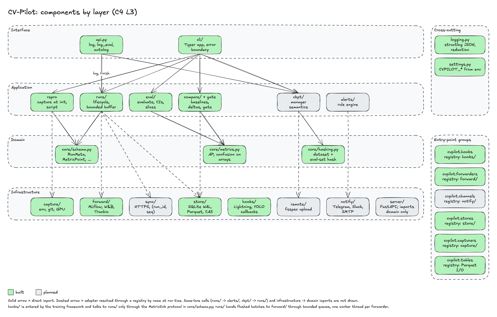

# 02 Components



The package follows the four layers of
[ADR-0004](../adr/0004-layering-and-dependency-rule.md). Built today: `cli/`, `api.py`,
`runs/`, `repro`, `core/` (schema, hashing, ULIDs, redaction, errors), `store/`, `capture/`,
`registry.py`, `logging.py` and `settings.py`; each section below states what part is built.
Every other package is planned and its interface is the contract it will be built to.

| Layer | Packages |
|---|---|
| Interface | `cli/` (built), `api.py` (built: `init`, `log`, `log_artifact`, `log_eval`, `finish`) |
| Application | `runs/` (built), `repro` (built), `eval/` (built), `compare/` (baselines built; compare and `gate` follow), `ckpt/`, `alerts/` |
| Domain | `core/schema.py`, `core/hashing.py` (built); `core/ulid.py`, `core/redact.py`, `core/jsonable.py`, `core/errors.py` (built); `core/metrics.py`, `core/confusion.py` (built) |
| Infrastructure | `store/`, `capture/` (built); `hooks/`, `forward/`, `sync/`, `remote/`, `notify/`, `server/` |
| Cross-cutting | `logging.py`, `settings.py`, `registry.py` (built) |

Signatures use `Literal` and Pydantic models from `core/schema.py`; `PredictionTable` and
`AnnotationTable` are typed wrappers over Arrow tables with the columns given in
[03-data-model.md](03-data-model.md).

## Interface layer

### `cli/`

Responsibility: Typer application, option parsing, the single error boundary, exit codes,
`stdout` for results and `stderr` for logs.

Public interface (built):

```python
def main() -> NoReturn            # entry point `cvpilot`; exit 0/1/2/130
# commands: --version, doctor, runs list|show, repro, eval, baseline set|list|show
```

`runs list|show` and `repro` accept `--project` (default `CVPILOT_PROJECT`; missing gives exit
2); `runs ls` is a hidden alias of `runs list`; `runs show --json` prints
`{meta, repro, metrics, artifacts}`. A malformed run id is a usage error (exit 2); a
well-formed id that is not in the store is a failure (exit 1, `command_failed`), following
the exit-code table in [06-cross-cutting.md](06-cross-cutting.md). A store written by a newer
library exits 1 with `store_version_unsupported`. `repro` prints a bash script (checkout of
`git_commit`, `git apply` of the stored diff, environment and dataset notes as comments, the
recorded command) on `stdout`.

Planned commands (each documents its exit codes in `--help` and in [04-flows.md](04-flows.md)):

```
cvpilot runs ls [--project P] [--status S] [--json]
cvpilot runs show <run_id> [--json]
cvpilot eval <run_id> --preds preds.parquet --gts gts.parquet --classes names.txt [--slices key=column]... [--step N] [--seed N] [--resamples N] [--json]
cvpilot compare <run_id> --baseline (tag:<tag>|<run_id>) [--eval-set NAME] --report cmp.html
cvpilot gate <run_id> --baseline ... [--max-drop K=V]... [--per-class-max-drop K=V]...
             [--slice-max-drop "key=*:V"]... [--min-images N]
cvpilot baseline set <tag> <run_id> [--eval-set HASH] [--step N] [--replace] | list [--history] | show <tag>
cvpilot ckpt ls <dir> | verify <dir> | restore <dir> [--to PATH]
cvpilot repro <run_id>
cvpilot sync [--project P] [--once]
cvpilot import (trackio|mlflow|tensorboard) <path> --project P
cvpilot server [--host H] [--port N]        # requires the [server] extra
```

Depends on: application packages (`runs/`, `repro`), `settings.py`, `logging.py`. Status:
built (`--version`, `doctor`, `runs list`, `runs show`, `repro`, `eval`, `baseline set|list|show`; `eval-file` is a hidden alias); planned (all other commands).

### `api.py`

Responsibility: the public Python API; holds the active run for the process; converts user
inputs into domain objects; delegates to `runs/`, `eval/`, `ckpt/`, `alerts/`.

```python
def init(
    project: str | None = None,          # default: CVPILOT_PROJECT
    *,
    task: Literal["detection", "classification"],
    name: str | None = None,
    config: Mapping[str, Any] | None = None,
    dataset_uri: str | PathLike[str] | None = None,
    seed: int | None = None,
    framework: str | None = None,        # "<name>==<version>", default the running Python
    resume_from: str | None = None,      # run id of a preempted or failed run
    store_dir: str | PathLike[str] | None = None,   # default: CVPILOT_STORE_DIR
) -> Run                                 # built; `forward_to` and `resume: bool` are planned
def log(points: Mapping[str, float], *, step: int, epoch: int | None = None) -> None
def log_eval(
    preds: PredictionTable,
    gts: AnnotationTable,
    *,
    step: int,
    class_names: Sequence[str] | None = None,   # default: ["0", ...] up to the largest GROUND-TRUTH id
    slices: Mapping[str, str] | None = None,
) -> EvalSnapshot
def log_artifact(path: str | PathLike[str], *, kind: ArtifactKind, meta: Mapping[str, Any] | None = None) -> Artifact
def finish(status: Literal["finished", "failed"] = "finished") -> None
def autolog(target: object, *, project: str, forward_to: Sequence[str] = (), **init_kwargs: Any) -> Run
def resume_path(project: str, *, checkpoint_dir: str | PathLike[str] | None = None) -> Path | None

class Run:                        # handle returned by init(); same methods bound to one run
    run_id: str
    def log(self, points: Mapping[str, float], *, step: int, epoch: int | None = None) -> None: ...
    def log_eval(self, preds: PredictionTable, gts: AnnotationTable, *, step: int, **kw: Any) -> EvalSnapshot: ...
    def finish(self, status: Literal["finished", "failed"] = "finished") -> None: ...
```

`autolog(target)` resolves the hook by inspecting `type(target)` against the `cvpilot.hooks`
registry and calls `hook.attach(target, sink)`; it raises `HookNotFoundError` naming the
extra or plugin to install.

One run is active per process (`RunAlreadyActiveError` otherwise); `Run` is a context manager
(`failed` on an exception). An `atexit` hook flushes buffered points but leaves the status
`running`, so a process that dies without `finish` is visibly unfinished.

Depends on: `runs/`, `repro`, `core/schema.py`, `settings.py`, `logging.py`; later `eval/`,
`ckpt/`. Status: built (`init`, `log`, `log_artifact`, `log_eval`, `finish`, `Run`); planned (`autolog`, `resume_path`, `forward_to`).

## Application layer

### `runs/`

Responsibility: run lifecycle use cases; the `MetricSink` implementation handed to hooks;
status transitions; hand-off of every record to the store, the forwarders, the outbox and
the client-side alert rules.

```python
def start_run(meta: RunMeta, repro: Repro, *, store_dir=None, git_diff: bytes | None = None) -> RunHandle
def log_points(run: RunHandle, points: Mapping[str, float], *, step: int, epoch: int | None = None) -> None
def finish_run(run: RunHandle, status: Literal["finished", "failed", "preempted"]) -> None
def resume_from(parent: RunMeta, *, run_id: str, host: str, name: str | None) -> RunMeta
def recover_run(project: str, run_id: str, *, store_dir=None) -> None   # running -> failed
def list_runs(project: str, *, status: RunStatus | None = None, store_dir=None) -> list[RunMeta]
def get_run_view(project: str, run_id: str, *, store_dir=None) -> RunView   # meta, repro, stats, artifacts

class RunHandle:                  # implements MetricSink.log and log_artifact
    def log(self, points: Mapping[str, float], *, step: int, epoch: int | None = None) -> None
    def flush(self) -> None
    def finish(self, status: Literal["finished", "failed", "preempted"] = "finished") -> None
```

`log` validates the whole call, buffers at most 10 000 points and writes one Parquet batch on
the caller's thread when that bound is reached or 2 s have passed since the last flush
(checked on each call; there is no timer thread). The longest a training step waits on I/O is
one batch write. A failed write keeps the points buffered and raises `StoreError`. A step must
be strictly greater than the last step logged for the same key (`DuplicateMetricError` for an
equal step, `MetricOrderError` for a lower one). `finish` flushes, compacts the metric files,
sets the final status and logs `run_finished`; a run whose process died stays `running` until
`recover_run` marks it `failed`. `resume_from` accepts only `preempted` or `failed` parents.

Depends on: `core/`, registry `stores`. Status: built (lifecycle, queries, recovery, resume
metadata); planned: `log_snapshot`, forwarders, the outbox and client-side alerts.

### `eval/`

Responsibility: compute an `EvalSnapshot` from predictions and ground truth; per-class,
confusion with background, slices, size ranges (small, medium, large AP and AR); bootstrap confidence intervals over images;
record the result in a run.

```python
def evaluate(
    preds: PredictionTable, gts: AnnotationTable, *,
    task: Literal["detection", "classification"], class_names: Sequence[str],
    slices: Mapping[str, str] | None = None,      # slice key -> image metadata column
    iou_thresholds: Sequence[float] | None = None,  # COCO grid by default
    n_resamples: int = 1000, seed: int = 0, level: float = 0.95, workers: int = 4,
    confusion_iou: float = 0.5, confusion_score: float = 0.25,
) -> EvalResult                    # .to_snapshot(run_id=, step=, confusion_sha256=, predictions_sha256=)
def eval_set_hash(gts: AnnotationTable, class_names: Sequence[str], *, task=...) -> str
def bootstrap_ci(per_image: np.ndarray, *, n_resamples: int = 1000, seed: int = 0,
                 level: float = 0.95) -> tuple[float, float]
def record_eval(store, meta, preds, gts, *, step, class_names=None, slices=None, ...) -> EvalSnapshot
```

Inputs are `PredictionTable`, `AnnotationTable` and `ImageTable` (`eval/tables.py`): NumPy
columns built from lists, arrays or Arrow tables (`from_columns`, `from_table`). Image ids are
strings; boxes are `x1, y1, x2, y2`. The `AnnotationTable` carries the image list (including
images without boxes, sizes and metadata columns for slices). `eval/validate.py` rejects
non-finite scores and boxes, reversed boxes, class ids outside `[0, C)`, duplicated image ids,
predictions or labels for images outside the evaluation set, ground-truth boxes outside the
image, and counts above the named limits (`MAX_PREDICTIONS` and `MAX_ANNOTATIONS` 5 000 000,
`MAX_IMAGES` 1 000 000, `MAX_ANNOTATIONS_PER_IMAGE` 100 000, `MAX_CLASSES` 2 048,
`MAX_SLICE_VALUES` 256 per key, `MAX_SLICE_KEYS` 16, `MAX_RESAMPLES` 10 000). A slice key with
more values raises `SliceCardinalityError` before any metric is computed.

`record_eval` (arguments `allow_closed`, `provenance`; used by `RunHandle.log_eval`, `api.log_eval` and `cvpilot eval`) hashes the
ground truth, refuses an existing `(run, hash, step)`, evaluates, stores `predictions` and
`confusion` Parquet artifacts (confusion as sparse `(true_class, pred_class, count)` rows,
index `C` is background) and then the snapshot, and logs `eval_completed`. `eval/files.py`
reads the CLI's Parquet files through the `tables` registry (bounded: file size, rows, row
groups, decoded bytes, string widths).

The bootstrap resamples images with a seeded generator. Matching is per image, so one matching
pass serves every resample: weights are image multiplicities (`core.metrics.accumulate`
accepts them, slices use 0/1 weights) and a vectorised resampler works on true positives only.
Intervals cover `mAP50_95`, `mAP50`, `AR100` (detection) and `top1` (classification).

Deviations from the first sketch: `evaluate` returns an `EvalResult` (a snapshot needs a run id
and artifact hashes), takes the image list inside `AnnotationTable`, and slices map a key to a
metadata column. Metric values are fractions in [0, 1]; undefined ones are omitted. Parity with
pycocotools (tolerance 1e-4) is a test in the default suite, `tests/parity/`; the definitions are
in the `core/metrics.py` docstring. Depends on: `core/metrics.py`, `core/confusion.py`,
`core/hashing.py`, `core/schema.py`; store and Parquet I/O through the `stores` and `tables`
registries. Status: built.

### `compare/` and `gate`

Responsibility: load two snapshots, refuse when `eval_set_hash` differs, compute headline,
per-class and per-slice deltas with bootstrap CIs, render the HTML report with the
prediction-diff gallery, evaluate thresholds, return the exit code.

```python
@dataclass(frozen=True)
class Thresholds:
    max_drop: Mapping[str, float]              # {"mAP50_95": 0.5}
    per_class_max_drop: Mapping[str, float]    # {"AP50_95": 2.0}
    slice_max_drop: Mapping[str, float]        # {"camera=*": 1.5}
    min_images: int = 30

def compare(candidate: EvalSnapshot, baseline: EvalSnapshot, *, seed: int = 0) -> Comparison
def render_report(cmp: Comparison, out: Path, *, max_gallery_images: int = 200) -> Path
def gate(cmp: Comparison, thresholds: Thresholds) -> GateResult   # .passed, .violations
```

`compare()` raises `EvalSetMismatchError` when the hashes differ; the CLI logs
`compare_refused` and exits 1. Depends on: `core/metrics.py`, `core/schema.py`; `stores`
registry. Status: planned.

### `ckpt/`

Responsibility: checkpoint manager semantics from [ADR-0006](../adr/0006-checkpoint-semantics.md).

```python
class CheckpointManager:
    def __init__(
        self,
        run: Run,
        *,
        dir: str | PathLike[str],
        remote: str | None = None,
        keep_last: int = 3,
        keep_best: int = 2,
        monitor: str | None = None,
        mode: Literal["max", "min"] = "max",
        every_n_minutes: float | None = None,
        every_n_steps: int | None = None,
        signals: Sequence[int] = (signal.SIGTERM, signal.SIGUSR1),
    ) -> None
    def maybe_save(self, step: int, *, model: Any, optimizer: Any | None = None,
                   scheduler: Any | None = None, scaler: Any | None = None, rng: bool = True,
                   dataloader_state: Mapping[str, Any] | None = None,
                   metrics: Mapping[str, float] | None = None) -> CheckpointManifest | None
    def save_now(self, step: int, **state: Any) -> CheckpointManifest
    def restore_latest_valid(self, *, map_location: str = "cpu") -> dict[str, Any] | None
    def verify(self, manifest: CheckpointManifest) -> bool
    def preempted(self) -> bool
```

Depends on: `core/hashing.py`, `core/schema.py`; `remote/` through the `remotes` registry;
`torch` and `safetensors` imported inside the functions that need them. Status: planned.

### `alerts/`

Responsibility: rule engine over the stream of metric points, snapshots and status changes;
dedupes and rate-limits; hands `Alert` objects to channels. Runs inside the training process
and inside the server.

```python
class Rule(Protocol):
    name: str
    def feed(self, event: RunEvent) -> Alert | None: ...

RULES: Mapping[str, type[Rule]]   # nan_loss, loss_spike, no_progress, gpu_util_below,
                                  # eval_regression_vs_baseline, new_best, failed, preempted, resumed
def evaluate(rules: Sequence[Rule], event: RunEvent) -> list[Alert]
def deliver(alerts: Sequence[Alert], channels: Sequence[str]) -> None   # via `channels` registry
```

Depends on: `core/schema.py`; `notify/` through the `channels` registry. Status: planned.

### `repro`

Responsibility: assemble the `Repro` record at `init` and print a reproduction script.

```python
def capture_repro(run_id, dataset_uri: str | None, config, seed, *, store_command_line: bool = True,
                  argv=None, cwd=None) -> Captured        # Repro + diff bytes + host
def script(view: RunView) -> str                          # bash: checkout, diff, env notes, command
```

`store_command_line` is passed from `Settings.store_command_line`; capture never reads the
environment itself. Depends on: `core/hashing.py`, `core/schema.py`, `core/jsonable.py`;
`capture/` through the `capturers` registry. Status: built.

## Domain layer

### `core/schema.py`

Responsibility: the Pydantic models `RunMeta`, `Repro`, `MetricPoint`, `EvalSnapshot`,
`Artifact`, `CheckpointManifest`, `Baseline`; the `MetricSink` protocol hooks talk to; the
`RunEvent` union consumed by alert rules; validators for the invariants in
[03-data-model.md](03-data-model.md).

```python
class MetricSink(Protocol):
    def log(self, points: Mapping[str, float], *, step: int, epoch: int | None = None) -> None: ...
    def log_eval(
        self, preds: PredictionTable, gts: AnnotationTable, *, step: int
    ) -> EvalSnapshot: ...
    def log_artifact(
        self, path: Path, *, kind: ArtifactKind, meta: Mapping[str, Any] | None = None
    ) -> Artifact: ...
    def checkpoint_saved(self, manifest: CheckpointManifest) -> None: ...
```

Phase 1 built `RunMeta`, `Repro`, `MetricPoint`, `Artifact`, `MetricStats`, the `RunStore`
port that `runs/` uses and `MetricSink` with `log` and `log_artifact`; `EvalSnapshot`,
`CheckpointManifest`, `Baseline`, `RunEvent` and `MetricSink.log_eval/checkpoint_saved` are
planned. `Repro` redacts `command_line` and `config` on construction
(`core/redact.py`, [06-cross-cutting.md](06-cross-cutting.md)). `core/ulid.py` generates
monotonic ULIDs, `core/errors.py` holds the specific exceptions the CLI boundary reports.

Depends on: pydantic, stdlib. Status: built (subset above); planned (rest).

### `core/hashing.py`

```python
def sha256_file(path: Path, *, chunk_size: int = 1 << 20) -> str
def dataset_hash(dataset_uri: str) -> str      # "dcp:<version>" or "merkle:<hex>"
def merkle_hash(root: Path) -> str
def eval_set_hash(class_names, image_ids, widths, heights, ann_image, ann_cls, ann_boxes, ann_crowd) -> str
def new_run_id() -> str                         # ULID
```

Depends on: stdlib. Status: built (`sha256_file`, `dataset_hash`, `merkle_hash`,
`new_run_id`, `eval_set_hash`).

### `core/metrics.py` and `core/confusion.py`

Pure functions on NumPy arrays; no I/O, no framework types.

```python
def match_detections(pred_image, pred_boxes, pred_scores, pred_cls, gt_image, gt_boxes, gt_cls, *,
                     n_images, n_classes, iou_thresholds, iscrowd=None, max_dets=100) -> MatchResult
def accumulate(match, *, image_weights=None, areas=None, max_dets=None) -> Curves  # [T, R, K, A, M]
def summarize(curves, iou_thresholds=None) -> dict[str, float]   # the 12 COCO numbers, -1 undefined
def per_class_ap(curves, *, iou=None, area="all") -> np.ndarray
def confusion_matrix(pred_image, pred_boxes, pred_scores, pred_cls, gt_image, gt_boxes, gt_cls, *,
                     n_images, n_classes, iscrowd=None, iou=0.5, score=0.25) -> np.ndarray  # (C+1)x(C+1)
def classification_metrics(true_cls, pred_cls, *, n_classes) -> ClassificationResult
```

Image indices are part of the signatures (matching is per image), which the first sketch left
out. Depends on: numpy (`core/schema.py` and `core/hashing.py` import it lazily so the CLI
start-up stays light). Status: built.

## Infrastructure layer

### `store/`

Responsibility: the local run store of [ADR-0005](../adr/0005-run-store.md): SQLite WAL for
rows, Parquet for metric points, content-addressed artifacts, DuckDB queries, migrations,
outbox table for `sync/`.

```python
class RunStore(Protocol):
    def open(project: str, root: Path | None = None) -> "RunStore": ...
    def put_run(self, meta: RunMeta, repro: Repro) -> None
    def set_status(self, run_id: str, status: RunStatus, ended_at: datetime | None) -> None
    def append_points(self, points: Sequence[MetricPoint]) -> None
    def put_snapshot(self, snapshot: EvalSnapshot) -> None
    def put_artifact(self, run_id: str, path: Path, kind: ArtifactKind, meta: Mapping[str, Any]) -> Artifact
    def put_manifest(self, manifest: CheckpointManifest) -> None
    def put_baseline(self, baseline: Baseline, *, replace: bool = False) -> None   # append-only, digested, chained
    def get_baseline(self, tag: str) -> Baseline                  # verified on every read
    def list_baselines(self, *, history: bool = False) -> list[Baseline]
    def snapshot_digest(self, run_id: str, eval_set_hash: str, step: int) -> str
    def get_snapshot(self, run_id: str, eval_set_hash: str, step: int | None = None) -> EvalSnapshot
    def query(self, sql: str, params: Mapping[str, Any] = {}) -> pa.Table      # DuckDB over runs.sqlite + metrics/*.parquet
    def outbox_pull(self, limit: int) -> list[OutboxItem]
    def outbox_ack(self, run_id: str, seq: int) -> None
```

Built (`store/local.py`, adapter `local` of the `stores` registry): `put_run`, `get_run`,
`get_repro`, `list_runs`, `set_status`, `append_points`, `read_points`, `metric_stats`,
`compact_metrics`, `put_artifact`, `put_artifact_bytes`, `list_artifacts`, `artifact_path`,
`put_snapshot`, `get_snapshot`, `list_snapshots`, `has_snapshot`, `snapshot_digest`, `put_baseline`, `get_baseline`, `list_baselines`, migrations (`store/migrations/0001_initial.py`), validated paths (`store/paths.py`). The
`RunStore` protocol lives in `core/schema.py` so `runs/` can type against it without
importing `store/`. The `eval_snapshot` table is additive (`store/additive.py`, created idempotently
at open, schema version unchanged; the database refuses UPDATE and DELETE on it). Parquet
reading for evaluation lives in `store/tables.py` (adapter `parquet` of the `tables` registry,
protocol `TableIO` in `core/schema.py`). Planned: `put_manifest`, `query`
(DuckDB), `outbox_*`.

Depends on: `core/schema.py`; sqlite3 and pyarrow (imported inside functions). Status: built
(run, metric, artifact and eval snapshot paths, Parquet tables); planned (the rest).

### `capture/`

Environment capture in `capture/env.py`: `git` (commit, dirty flag over tracked files, diff
of tracked changes with fsmonitor, external diff and textconv disabled), lockfile hash
(`uv.lock` or `poetry.lock` up to the repo root, else a hash of the installed set), Python,
CUDA and driver and GPU names (`pynvml` if importable, else `nvidia-smi`, else none; `torch`
is never imported), hostname, and the command line redacted per argument (`redact_argv`)
before quoting. Each capturer is a function registered under `capturers`, with optional
keyword parameters (`cwd`, `argv`, `store_command_line`); absent facilities give `None` or
empty values, never errors. Depends on: stdlib, `pynvml` (imported lazily). Status: built;
planned: the NVML sampler thread (every 10 s).

### `hooks/`

Framework adapters. Each adapter implements:

```python
class Hook(Protocol):
    name: str  # "lightning", "hf", "mmengine", "rfdetr", "torch"
    requires: tuple[str, ...]  # distributions that must be importable

    def matches(self, target: object) -> bool: ...
    def attach(self, target: object, sink: MetricSink) -> None: ...
    def detach(self) -> None: ...
```

| Adapter | Mechanism | Captured |
|---|---|---|
| `hooks/lightning.py` | `CVPilotLogger` plus `CVPilotCallback` wrapping `ModelCheckpoint` | `self.log` scalars, eval snapshots, checkpoints |
| `hooks/hf_trainer.py` | `TrainerCallback`: `on_log`, `on_evaluate`, `on_save` | scalars, eval, checkpoints |
| `hooks/mmengine.py` | MMEngine hook plus `VisBackend` | scalars, COCO metrics, checkpoints |
| `hooks/rfdetr.py`, `hooks/torch_loop.py` | context manager plus explicit `log_eval` | explicit |
| `hooks/ultralytics.py` (`cvpilot[ultralytics]`, AGPL-3.0 notice) | `add_callback("on_fit_epoch_end" / "on_model_save" / "on_train_end")`; reads `validator.metrics.box.maps` and the confusion matrix | losses, mAP, per-class AP, confusion, best/last |

Hooks import only `core/` and their framework, and the framework only inside `attach()`
and the callback bodies. `hooks/ultralytics.py` is the one adapter that imports a copyleft
package; its `--help` text and docstring carry the AGPL-3.0 notice required by
[dependencies-and-licensing.md](../engineering/dependencies-and-licensing.md). Depends on:
`core/schema.py`. Status: planned.

### `forward/`

```python
class Forwarder(Protocol):
    name: str  # "mlflow", "wandb", "trackio", "tensorboard"
    requires: tuple[str, ...]

    def open(self, meta: RunMeta, repro: Repro) -> None: ...
    def log_points(self, points: Sequence[MetricPoint]) -> None: ...
    def log_artifact(self, artifact: Artifact, path: Path) -> None: ...
    def close(self, status: RunStatus) -> None: ...
```

A forwarder failure is logged once at `WARN` (`forward_failed`) and never stops training.
Depends on: `core/schema.py`; tracker SDK inside the adapter. Status: planned.

### `sync/`

Background thread that pulls the outbox, posts batches to `CVPILOT_SERVER_URL` over HTTPS
with the token in a header, retries with exponential backoff (1 s to 60 s, jitter), and acks
`(run_id, seq)` on HTTP 200 or 409 (already stored). Uses stdlib `urllib.request` with a
10 s timeout; no extra needed. Depends on: `core/schema.py`, `settings.py`. Status: planned.

### `remote/`

fsspec upload and download for checkpoints and artifact export, with size and checksum
verification after transfer. Registered under `remotes` keyed by URL scheme. Depends on:
`fsspec` and the backend package (`s3fs`, `gcsfs`) imported lazily. Status: planned.

### `notify/`

Channel adapters: Telegram Bot API, Slack incoming webhook, generic webhook, SMTP.

```python
class Channel(Protocol):
    name: str
    requires: tuple[str, ...]

    def send(self, alert: Alert) -> None: ...
```

Depends on: `core/schema.py`; `httpx` from the `[alerts]` extra for HTTP channels, stdlib
`smtplib` for SMTP. Status: planned.

### `server/`

Its own package with its own entry point (`cvpilot server`), shipped as a Docker image.
Imports `core/` only; never `runs/`, `store/` or `cli/`. Routes: `POST /api/v1/runs`,
`POST /api/v1/runs/{run_id}/events` (idempotent on `(run_id, seq)`), `GET /api/v1/runs`,
`GET /api/v1/runs/{run_id}/snapshots`, `WS /ws/runs/{run_id}`, `GET /share/{token}`, htmx
pages under `/ui`. Every route requires a project token except `/healthz` and valid share
links. Depends on: `core/schema.py`; FastAPI, Uvicorn, SQLAlchemy (SQLite or Postgres)
from the `[server]` extra. Status: planned.

## Cross-cutting

- `logging.py` (built): structlog processor chain per
  [errors-and-logging.md](../engineering/errors-and-logging.md).
- `settings.py` (built): `CVPILOT_ENV`, `CVPILOT_LOG_LEVEL`, `CVPILOT_PROJECT`,
  `CVPILOT_STORE_DIR`, `CVPILOT_STORE_COMMAND_LINE`; planned keys in
  [05-runtime.md](05-runtime.md).

## Registries and the plugin contract

`cvpilot/registry.py` (built; `stores` and `capturers` are populated, the other groups arrive
with their packages) exposes `Registry[T]` with `get(name) -> T`,
`names() -> list[str]` and `find(predicate) -> T | None`. Each registry is populated lazily
from entry points on first use; first-party adapters are declared in `pyproject.toml` under
the same groups, so first- and third-party adapters are indistinguishable to application
code.

| Registry | Entry-point group | Key | Plugin declares |
|---|---|---|---|
| `hooks` | `cvpilot.hooks` | hook name | a class implementing `Hook` with `name`, `requires`, `matches`, `attach`, `detach` |
| `forwarders` | `cvpilot.forwarders` | tracker name | a class implementing `Forwarder` |
| `channels` | `cvpilot.channels` | channel name | a class implementing `Channel` |
| `remotes` | `cvpilot.remotes` | URL scheme | a callable returning an fsspec filesystem |
| `capturers` | `cvpilot.capturers` | field group | a callable `() -> Mapping[str, Any]` |
| `stores` | `cvpilot.stores` | store name (`local` default) | a class implementing `RunStore` |

Rules for a plugin:

1. `requires` lists distribution names; the registry checks `importlib.metadata` before
   importing the module and raises `MissingExtraError("install cvpilot[lightning]")` or the
   plugin package name.
2. A plugin imports `cvpilot.core` only. Importing `cvpilot.runs`, `cvpilot.store` or
   `cvpilot.cli` from a plugin is rejected in review and by the import-linter contract.
3. A plugin that includes or derives from copyleft code is a separate distribution; a
   plugin that only imports a copyleft package lazily may live in this package as an extra.

## Dependency rule in this project

Forbidden imports, checked by review and by an import-linter contract once more than one
layer is populated:

- `core/*` importing anything from `cvpilot` outside `core/`, or importing `torch`,
  `pyarrow`, `duckdb`, `fsspec`, `fastapi`, any framework or tracker SDK.
- `store/`, `capture/`, `hooks/`, `forward/`, `sync/`, `remote/`, `notify/`, `server/`
  importing `runs/`, `eval/`, `compare/`, `ckpt/`, `alerts/`, `repro`, `api.py` or `cli/`.
- `runs/`, `eval/`, `compare/`, `ckpt/`, `alerts/`, `repro` importing `store/`, `capture/`,
  `hooks/`, `forward/`, `sync/`, `remote/`, `notify/` or `server/` by module path (they go
  through `registry.py`).
- `cli/` or `api.py` importing any infrastructure package directly.
- Any module importing `torch`, a framework SDK, a tracker SDK, `fastapi`, `httpx` or
  `pynvml` at module top level; these imports live inside the adapter function that needs
  them.
- `logging.py` and `settings.py` importing any other `cvpilot` module.
- Any module other than `hooks/ultralytics.py` importing `ultralytics` (or any other
  copyleft package); inside that adapter the import is local to the function, never at
  module top level, and never reachable from `core/` or an application package.
