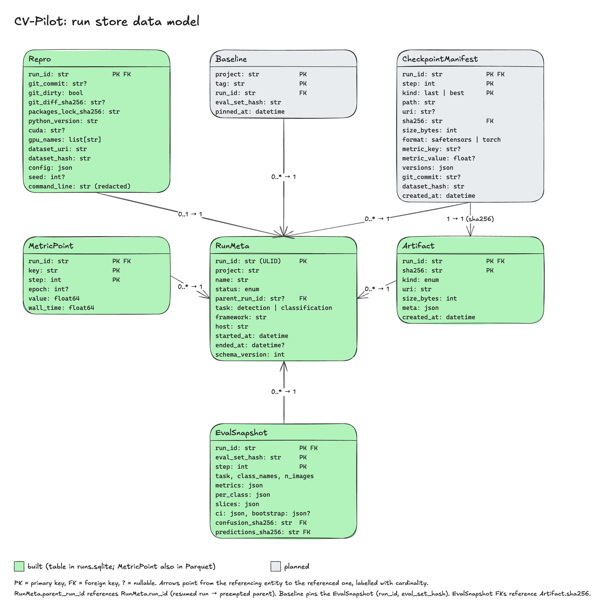

# 03 Data model



Every record is a Pydantic model in `core/schema.py` and a row in the local run store
([ADR-0005](../adr/0005-run-store.md)). Timestamps are timezone-aware UTC. `json` means a JSON
column checked against the model on read.

## Records

### RunMeta

One training run. A resumed run is a new `RunMeta` whose `parent_run_id` points at the preempted
one.

| Field | Meaning |
|---|---|
| `run_id` | [ULID](../guide/concepts.md#glossary), made once at `init`. Primary key. |
| `project` | Store folder name, `[a-z0-9][a-z0-9-_]{0,63}`. |
| `name` | Human label; defaults to `<framework>-<date>`. |
| `status` | `running`, `resumed`, `finished`, `failed` or `preempted`. |
| `parent_run_id` | The preempted or failed run this one continues, or none. |
| `task` | `detection` or `classification`. |
| `framework`, `host` | `"<name>==<version>"`; hostname only, never user name or IP. |
| `started_at`, `ended_at` | `ended_at` is set by `finish`. |
| `schema_version` | The store schema the row was written with. |

### Repro

How to reproduce the run, captured once at `init`. One-to-one with `RunMeta`.

| Field | Meaning |
|---|---|
| `git_commit`, `git_dirty`, `git_diff_sha256` | Commit, uncommitted changes, and the diff's content address. |
| `packages_lock_sha256` | Hash of `uv.lock`, `poetry.lock` or `pip freeze`. |
| `python_version`, `cuda`, `gpu_names` | Environment; empty on CPU. |
| `dataset_uri`, `dataset_hash` | Where the data was read, and `dcp:<version>` or `merkle:<hex>`. |
| `config`, `seed` | The resolved training config (redacted) and seed. |
| `command_line` | `sys.argv` with secrets redacted. |

### MetricPoint

One scalar at one step, stored in Parquet under `metrics/<run_id>/`. Key: `(run_id, key, step)`.

| Field | Meaning |
|---|---|
| `key` | `"<split>/<metric>[/<class>]"`, for example `val/AP/coke_zero_330ml`. |
| `step` | Optimizer step, at least 0, strictly increasing per key within a run. |
| `epoch`, `wall_time` | Optional epoch; Unix seconds at log time. |
| `value` | `float64`. NaN and infinity are allowed; NaN triggers the `nan_loss` alert. |

### EvalSnapshot

One evaluation of one run on one evaluation set at one step. Key:
`(run_id, eval_set_hash, step)`. Never edited.

| Field | Meaning |
|---|---|
| `task`, `class_names`, `n_images` | What was scored. Class order is the class id. |
| `metrics` | Headline metrics as fractions in [0, 1]: `mAP50_95`, `mAP50`, `AR100`, `top1`, and others. Undefined ones are absent. |
| `per_class` | Class name to `{AP50_95, AP50, AR100, support}`. |
| `slices` | `"camera=cam03"` to `{mAP50_95, n_images}`. |
| `ci`, `bootstrap`, `ci_status` | [Bootstrap intervals](../guide/concepts.md#glossary), and the seed, resample count and level that made them. |
| `params` | IoU grid and confusion settings, so `compare` can refuse snapshots made differently. |
| `provenance` | Optional `{checkpoint_sha256, git_commit}` from the caller. |
| `slice_spec`, `slice_hash` | Slice key to metadata column, and a hash of every slice column's values. |
| `confusion_sha256`, `predictions_sha256` | Artifacts holding the confusion matrix and the predictions. |

**Integrity** (`store/snapshots.py`). The index row stores the digest of the exact JSON bytes and a
[hash chain](../guide/concepts.md#glossary) value over the run's earlier rows. Every read re-hashes
the file and recomputes the chain, and a mismatch raises `SnapshotIntegrityError`. Files are created
read-only inside the insert transaction and never replaced. This catches edited files, swapped
artifacts and removed or reordered rows. It does not catch someone who can write both the database
and the files, because nothing is signed.

### Artifact

A file produced by a run, stored by content address (`artifacts/<sha256[:2]>/<sha256>`). Key:
`(run_id, sha256)`. Fields: `kind` (`report`, `predictions`, `confusion`, `config`, `env`, `diff`,
and others), `uri`, `size_bytes`, `meta`, `created_at`. Checkpoints are not stored as artifacts.

### CheckpointManifest

The record written beside every checkpoint file ([ADR-0006](../adr/0006-checkpoint-semantics.md)).
Key: `(run_id, step, kind)`. The file is read-only once written.

| Field | Meaning |
|---|---|
| `kind`, `step`, `path` | `last` (full state) or `best` (weights and EMA); the checkpoint's step and relative path. |
| `uri` | Intended remote location. A `step_N.remote.json` marker records a verified upload. |
| `sha256`, `size_bytes`, `format` | What the file must match. `format` is `safetensors` or opt-in `pt`. |
| `metric_key`, `metric_value`, `metric_mode` | The monitored metric, for `best`. |
| `versions`, `git_commit`, `dataset_hash` | Provenance. |
| `prev_manifest_sha256`, `prev_chain_sha256`, `chain_sha256` | Links to the previous manifest. |
| `prev_step` | Step of that previous manifest, so a gap left by retention differs from a replaced file. |
| `schema_version`, `chain_version` | Format versions, covered by the tag. |
| `tag_alg`, `key_id`, `auth_tag` | HMAC-SHA256 tag and the key that made it, when `CVPILOT_CKPT_KEY` was set. |
| `project`, `parent_run_id` | Binding to a project and parent, covered by the tag. |
| `chain_reset`, `chain_reset_reason` | Set when `restart_chain=True` started a new chain on purpose. |

The run store keeps the digest of each manifest file in the append-only `checkpoint_manifest` table.
That is the outside anchor behind the `anchored` trust level. The `LATEST` pointer holds the run id,
kind, step, manifest name, digest and chain value, and an optional tag.

### Baseline

A named pin of one run's snapshot, used by `compare` and `gate`. The table is append-only:
replacing a tag adds a newer row, and the newest row is current.

| Field | Meaning |
|---|---|
| `project`, `tag` | Tag is `[a-z0-9][a-z0-9_-]{0,31}` and cannot start with `-`. |
| `run_id`, `eval_set_hash`, `step` | Which snapshot is pinned. |
| `snapshot_sha256`, `pinned_at` | The snapshot's digest when pinned, and the time. |

**Integrity** (`store/baselines.py`). Each row stores its record's SHA-256 and a chain value over all
earlier rows. Every read re-hashes the record, walks the whole chain and checks that the pinned
snapshot still has its pinned digest, or raises `BaselineIntegrityError`. Deleting the newest row is
invisible to the store itself, and undoing a `--replace` would make the old pin current. The control
is an outside anchor: `baseline show` prints `head_chain_sha256`, and
`gate --expect-baseline-chain` compares it with a value kept elsewhere.

## Relations

Everything refers to `RunMeta`: a run has at most one `Repro`, and any number of metric points,
snapshots, artifacts, checkpoint manifests and baselines. A run has at most one child through
`parent_run_id`. A snapshot refers to two artifacts (confusion and predictions). A baseline refers to
one snapshot.

## Invariants

1. A `run_id` is a valid ULID, made once per `init`.
2. A metric point is unique on `(run_id, key, step)`, and a step must exceed the last stored step of
   that key (`DuplicateMetricError`, `MetricOrderError`). A batch with a violation is rejected whole.
3. A snapshot is unique on `(run_id, eval_set_hash, step)` and immutable.
4. `compare` and `gate` require equal `eval_set_hash`, `task`, `class_names` and `params`. Otherwise
   they log `compare_refused` and exit 1 with no result.
5. An artifact's `sha256` is the hash of its bytes, and identical content is stored once.
6. A manifest row exists only after the file was synced, renamed into place, re-read and re-hashed.
   `LATEST` is rewritten last.
7. The newest verified checkpoint of each `(run, kind)` is never deleted.
8. Status moves only from `running` or `resumed` to `finished`, `failed` or `preempted`. A run with a
   parent starts as `resumed`. A terminal status never changes.
9. `parent_run_id` is set exactly when the run was created by `resume_from`. The parent is
   `preempted` or `failed`, and the parent chain has no cycle.
10. A baseline's run has a snapshot with the pinned `eval_set_hash` and `step`, or pinning is refused.
11. `dataset_hash` starts with `dcp:` when the dataset folder has a DataCopilot manifest, otherwise
    `merkle:`.
12. `command_line` and `config` hold no value whose key matches the redaction list.

## On-disk layout

```
$CVPILOT_STORE_DIR/<project>/              default ~/.cvpilot/<project>/
  runs.sqlite                               WAL mode: run_meta, repro, artifact, metric_files,
                                            eval_snapshot, baseline, checkpoint_manifest, meta
  metrics/<run_id>/<seq:06d>.parquet        batches in write order; compacted to all.parquet
                                            at finish
  evals/<run_id>/<eval_set_hash[:12]>_<step:09d>.json    the full snapshot; the SQLite row indexes it
  artifacts/<sha256[:2]>/<sha256>           content-addressed files

<checkpoint_dir>/<run_id>/
  last/step_<step:09d>.safetensors          full state: tensors plus bounded JSON
  last/step_<step:09d>.manifest.json        CheckpointManifest
  last/step_<step:09d>.remote.json          marker: uploaded and verified
  best/step_<step:09d>.safetensors          weights and EMA
  LATEST, LATEST_BEST                       newest manifest of each kind
  QUARANTINE                                refused steps
  .lock                                     held while saving, pruning or installing
```

A metric batch is indexed in `metric_files` only after its atomic rename, so a killed writer leaves
at most an unindexed file that readers ignore. Reports are written only to the path you give.

## Hashes and versions

- **File hashes** (`Artifact.sha256`, `CheckpointManifest.sha256`) are SHA-256 over the bytes.
- **`dataset_hash`** is `dcp:<version>` copied from `dataset.dcp/manifest.json` (a regular file of at
  most 1 MiB, a version of at most 190 characters from `A-Za-z0-9._-`), or `merkle:<hex>` over the
  sorted relative paths, sizes and modification times of the folder's files. Neither checks the
  file contents.
- **`eval_set_hash`** is SHA-256 over canonical JSON of the class names and, per image, the id, size
  and sorted boxes (coordinates rounded to 2 decimals, `iscrowd` included). It depends on the ground
  truth only, so two machines scoring the same set agree. It ignores file paths and times.
- **`schema_version`** lives in `runs.sqlite` and in each Parquet file's metadata. Migrations are
  forward-only and run when a newer library opens the store, after copying `runs.sqlite` to
  `runs.sqlite.bak-<version>`. A store newer than the library is refused (`store_version_unsupported`,
  exit 1). Adding a nullable field or table keeps the version. Renaming or removing a field raises it
  and needs an ADR note.
