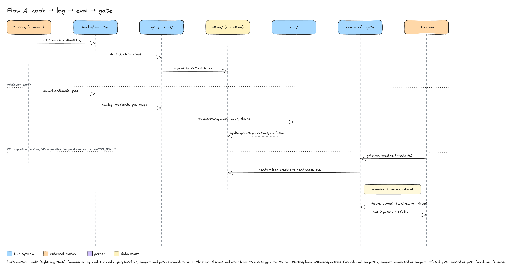
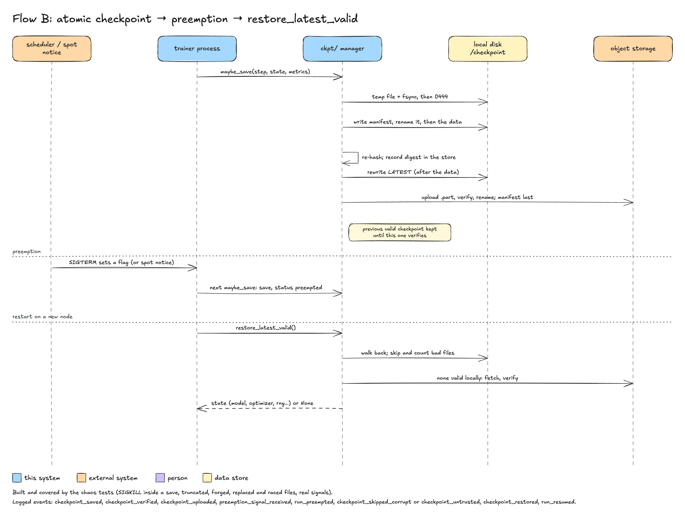

# 04 Flows

Exit codes follow [errors-and-logging.md](../engineering/errors-and-logging.md): `0` ok,
`1` the command ran and failed (including a gate that fails or a refused comparison), `2`
usage or configuration error, `130` interrupted. Log event names are the constant
`message` values of [06-cross-cutting.md](06-cross-cutting.md). Flow B is planned. In Flow A the
run-capture steps, the eval steps 3 and 4 and the compare and gate steps 5 to 8 are built; hooks
and forwarders are described in the status note under Flow A.

## Flow A: hook → log → eval → gate

Purpose: capture metrics and an evaluation snapshot from a training framework without
changing the training loop, then fail a CI job when the new run regresses against the
pinned baseline.

Preconditions:

- A run was started by `cvpilot.init()` or `cvpilot.autolog()`; the hook for the framework
  is installed (`cvpilot[ultralytics]`, `cvpilot[lightning]`, `cvpilot[hf]` or
  `cvpilot[mmdet]`).
- The validation set is available as `PredictionTable` and `AnnotationTable` at the end of
  a validation epoch, with `class_names` and optional slice metadata columns.
- For the gate: a baseline is pinned (`cvpilot baseline set prod <run_id> --eval-set ...`)
  and the CI runner can read the project store (checked-out copy, mounted bucket, or
  `--from-server`).

Sequence:

1. The framework fires `on_fit_epoch_end`; the hook converts the framework's scalars to
   `MetricPoint`s and calls `sink.log(points, step=...)`.
2. `runs/` validates the batch (invariant 2), appends it to the store, hands it to the
   forwarders, the outbox and the client-side alert rules; `metrics_flushed` is logged per
   Parquet file written.
3. At the end of a validation epoch the hook calls `sink.log_eval(preds, gts, step=...)`.
4. `eval/` computes `eval_set_hash`, matches detections, computes per-class AP, confusion,
   slices and headline metrics, writes `predictions.parquet` and `confusion.parquet` to the
   CAS and the `EvalSnapshot` row; `eval_completed` is logged with `eval_set_hash`, `step`
   and `n_images`.
5. In CI, `cvpilot gate <run_id> --baseline tag:prod ...` resolves the baseline (record, chain
   and pinned snapshot digest verified), loads the baseline snapshot and the candidate snapshot
   (latest step for the baseline's `eval_set_hash`), each verified against its digest and chain.
6. If the evaluation sets, tasks, class names or evaluation parameters differ the comparison is
   refused (invariant 4) and nothing else runs.
7. Otherwise `compare/` computes deltas (the bootstrap intervals are those stored in the
   snapshots) and `gate` evaluates the thresholds; the report is rendered when requested.
8. The command prints a one-line verdict and the violations to `stdout` and exits.

Failure paths:

| Failure | Behaviour | Exit | Event |
|---|---|---|---|
| Hook extra not installed | `autolog` raises `MissingExtraError` naming the extra; no object matches: `HookNotFoundError`; no run is started in either case | 1 (Python API raises; CLI not involved) | `hook_missing` |
| A callback fails inside the framework (store full, odd value) | caught by the hook's guard, counted, the first logged once; the hook is disabled after 10 failures in a row; the framework never sees an exception | n/a | `hook_failed`, `hook_disabled` (WARN) |
| Duplicate `(key, step)` in a batch | batch rejected, exception to the caller; training continues only if the caller catches it | n/a | `metrics_rejected` |
| Forwarder error (tracker down, slow or hung) | counted; the first failure per forwarder is logged once; the next batch is offered again (not after `open` failed or a stall); a full queue drops the batch; `log` and the training loop are never blocked or raised into | n/a | `forward_failed` (WARN, once), `forward_summary` (WARN, at finish) |
| Store write error (disk full, permissions) | `log()` raises `StoreError`; training loop decides | n/a | `store_write_failed` (ERROR) |
| `gate` run, baseline tag or run not found, or the project has no store | one line on `stderr` | 1 | `command_failed` |
| Unknown option, bad threshold syntax (`--max-drop mAP50_95`), no threshold given, `--min-images 0` | Typer usage error | 2 | none (usage errors are not logged) |
| `eval_set_hash`, task, class names, evaluation parameters or slice membership differ, a slice holds other images, the candidate has no snapshot for the baseline's set or step, the baseline is the candidate or not finished, the candidate's commit is not `--require-commit` | refused, no verdict and no report | 1 | `compare_refused` (with `reason`) |
| `--recompute` finds a stored result that differs from a re-evaluation on the trusted ground truth | no verdict | 1 | `gate_recompute_failed` |
| `--expect-baseline-chain` differs from the baseline table head (rollback) | no verdict | 1 | `baseline_integrity_failed` |
| A snapshot, the baseline row or the baseline chain fails verification | one line on `stderr`, no verdict | 1 | `snapshot_integrity_failed` or `baseline_integrity_failed` |
| Metric absent or not finite, slice absent or built from another column, evaluation set smaller than `--min-images`, per-class or slice threshold that gated nothing | violation listed | 1 | `gate_failed` |
| Slice smaller than `--min-images` | violation `slice_too_small`; with `--skip-small-slices` it is listed as skipped, counted against `--max-skipped` (default 0: any skip fails) and a threshold whose slices were all skipped still fails | 1 (0 with the flag and a sufficient `--max-skipped`, when the other checks hold) | `gate_failed`; `slice_skipped` (WARN) with the flag |
| Any threshold exceeded (a drop above the limit, in points on the 0..100 scale) | violations printed, worst first | 1 | `gate_failed` |
| All thresholds hold (improvements never fail) | verdict printed | 0 | `gate_passed` |
| Unexpected exception anywhere in the command | one line on `stderr` | 1 | `command_failed` |
| Ctrl-C while the command runs | partial output discarded | 130 | none |

Logged events (in order of a successful flow): `run_started`, `hook_attached`,
`metrics_flushed`, `eval_completed`, `compare_completed`, `gate_passed` or `gate_failed`,
`run_finished`.

Status: partly built. Built parts of this flow: `cvpilot.init()` starts a run (`run_started`);
`log(points, step=...)` validates the batch (invariant 2), buffers and appends it to the store
as Parquet (`metrics_flushed`, DEBUG); `finish()` compacts and logs `run_finished`. Steps 3 and 4
are built: `Run.log_eval(preds, gts, step=...)` (or `cvpilot eval` for Parquet files) validates
the tables, hashes the evaluation set, refuses an existing `(run, hash, step)`, evaluates
(detection or top-1, slices, seeded bootstrap), stores `predictions.parquet` and
`confusion.parquet` in the CAS and the immutable snapshot, and logs `eval_completed` (INFO:
`run_id`, `step`, `eval_set_hash`, `n_images`, `n_classes`, `n_predictions`, `task`,
`duration_ms`). Evaluating into a finished, failed or preempted run needs `allow_closed` (`--allow-closed`);
`--checkpoint-sha256` and `--git-commit` record provenance. Failure paths of eval: a closed run, invalid tables, a limit exceeded, a slice cardinality
above 256, malformed Parquet or an existing snapshot give `EvalInputError`,
`SliceCardinalityError` or `SnapshotExistsError`, exit 1 with one `error:` line and one
`command_failed` event, and nothing is stored. Steps 5 to 8 are built: `cvpilot baseline`,
`cvpilot compare` and `cvpilot gate` (ADR-0007) read only verified snapshots and never trust a
stored comparison. Forwarders (ADR-0008) and the Lightning and Ultralytics hooks (steps 1 and 2, scalars only; `autolog`) are built; the outbox and alert rules are not built, and the
duplicate-batch failure is raised to the caller without a `metrics_rejected` event.
`cvpilot runs show` and `cvpilot repro` read the result.

## Flow B: atomic checkpoint → preemption → restore_latest_valid

Purpose: guarantee that a training job killed at any moment can resume from the newest
checkpoint that is complete and verified, locally or from object storage, with the run
lineage recorded.

Preconditions:

- `CheckpointManager(run, dir=..., remote=..., keep_last=3, keep_best=2, monitor=...)` is
  created inside the training process; signal handlers are installed on construction.
- `dir` is on local disk (or a bucket mounted in MOUNT mode for SkyPilot); `remote`, when
  set, is an fsspec URL with write access.
- The trainer calls `maybe_save` at step boundaries and `restore_latest_valid` before the
  first step.

Sequence (as built):

1. `maybe_save(step, ...)` decides whether to save (interval elapsed, `best` improved, or the
   preemption flag is set); otherwise returns `None`.
2. Under the directory lock, debris of a killed save is removed; the state is written to a
   private temp file (`O_EXCL`, mode 0600), `fsync`ed and made read-only.
3. SHA-256 is computed while the bytes are written; the manifest (size, digest, chain value to the
   previous manifest, optional HMAC tag) is written the same way.
4. The manifest is renamed into place, then the data file; the directory is `fsync`ed.
5. The data file is re-read and re-hashed (`verify_after_save`); the manifest digest is recorded in
   the run store; then `LATEST` is rewritten and `checkpoint_saved` and `checkpoint_verified` are
   logged with `step`, `size_bytes`, `sha256_prefix`, `kind`.
6. When `remote` is set, the data is uploaded to a `.part` object (resumed when the remote prefix
   equals the local prefix), size and SHA-256 are read back, it is renamed, the manifest is
   uploaded last and a local marker is written; `checkpoint_uploaded` is logged. Failures are
   logged and caught up by a later save.
7. Retention deletes valid checkpoints beyond `keep_last`/`keep_best`, never the newest valid one
   and, with a remote, only once the newest is confirmed there (ADR-0006 rule 4).
8. SIGTERM or SIGUSR1 (or a cloud notice, if polled) sets the flag; nothing else happens in the
   handler. The next `maybe_save` logs `preemption_signal_received`, saves inside the grace window,
   marks the run `preempted` and logs `run_preempted`; past the window it logs
   `preemption_save_incomplete` and the previous checkpoint is the resume point.
9. On restart, `restore_latest_valid()` walks back from the newest manifest: it must parse, match
   its name and run, chain, and have the required trust level, and the file must be a regular file
   of the right size, structure and SHA-256 (read once, parsed from the same bytes). A file that
   fails is skipped with `checkpoint_skipped_corrupt` (or `checkpoint_untrusted`). With nothing
   valid locally the newest remote checkpoints are fetched and verified before they are
   installed.
10. The trainer receives the state (or `None`); the child run (`init(resume_from=...)`, found with
    `resume_path` or `find_resume_point`) has `parent_run_id` and status `resumed`;
    `checkpoint_restored` (with `trust_level`) and `run_resumed` are logged.

Failure paths:

| Failure | Behaviour | Exit | Event |
|---|---|---|---|
| Hook extra not installed | `autolog` raises `MissingExtraError` naming the extra; no object matches: `HookNotFoundError`; no run is started in either case | 1 (Python API raises; CLI not involved) | `hook_missing` |
| A callback fails inside the framework (store full, odd value) | caught by the hook's guard, counted, the first logged once; the hook is disabled after 10 failures in a row; the framework never sees an exception | n/a | `hook_failed`, `hook_disabled` (WARN) |
| Duplicate `(key, step)` in a batch | batch rejected, exception to the caller; training continues only if the caller catches it | n/a | `metrics_rejected` |
| Forwarder error (tracker down, slow or hung) | counted; the first failure per forwarder is logged once; the next batch is offered again (not after `open` failed or a stall); a full queue drops the batch; `log` and the training loop are never blocked or raised into | n/a | `forward_failed` (WARN, once), `forward_summary` (WARN, at finish) |
| Store write error (disk full, permissions) | `log()` raises `StoreError`; training loop decides | n/a | `store_write_failed` (ERROR) |
| `gate` run, baseline tag or run not found, or the project has no store | one line on `stderr` | 1 | `command_failed` |
| Unknown option, bad threshold syntax (`--max-drop mAP50_95`), no threshold given, `--min-images 0` | Typer usage error | 2 | none (usage errors are not logged) |
| `eval_set_hash`, task, class names, evaluation parameters or slice membership differ, a slice holds other images, the candidate has no snapshot for the baseline's set or step, the baseline is the candidate or not finished, the candidate's commit is not `--require-commit` | refused, no verdict and no report | 1 | `compare_refused` (with `reason`) |
| `--recompute` finds a stored result that differs from a re-evaluation on the trusted ground truth | no verdict | 1 | `gate_recompute_failed` |
| `--expect-baseline-chain` differs from the baseline table head (rollback) | no verdict | 1 | `baseline_integrity_failed` |
| A snapshot, the baseline row or the baseline chain fails verification | one line on `stderr`, no verdict | 1 | `snapshot_integrity_failed` or `baseline_integrity_failed` |
| Metric absent or not finite, slice absent or built from another column, evaluation set smaller than `--min-images`, per-class or slice threshold that gated nothing | violation listed | 1 | `gate_failed` |
| Slice smaller than `--min-images` | violation `slice_too_small`; with `--skip-small-slices` it is listed as skipped, counted against `--max-skipped` (default 0: any skip fails) and a threshold whose slices were all skipped still fails | 1 (0 with the flag and a sufficient `--max-skipped`, when the other checks hold) | `gate_failed`; `slice_skipped` (WARN) with the flag |
| Any threshold exceeded (a drop above the limit, in points on the 0..100 scale) | violations printed, worst first | 1 | `gate_failed` |
| All thresholds hold (improvements never fail) | verdict printed | 0 | `gate_passed` |
| Unexpected exception anywhere in the command | one line on `stderr` | 1 | `command_failed` |
| Ctrl-C while the command runs | partial output discarded | 130 | none |

Logged events (in order of a successful flow): `run_started`, `hook_attached`,
`metrics_flushed`, `eval_completed`, `compare_completed`, `gate_passed` or `gate_failed`,
`run_finished`.

Status: partly built. Built parts of this flow: `cvpilot.init()` starts a run (`run_started`);
`log(points, step=...)` validates the batch (invariant 2), buffers and appends it to the store
as Parquet (`metrics_flushed`, DEBUG); `finish()` compacts and logs `run_finished`. Steps 3 and 4
are built: `Run.log_eval(preds, gts, step=...)` (or `cvpilot eval` for Parquet files) validates
the tables, hashes the evaluation set, refuses an existing `(run, hash, step)`, evaluates
(detection or top-1, slices, seeded bootstrap), stores `predictions.parquet` and
`confusion.parquet` in the CAS and the immutable snapshot, and logs `eval_completed` (INFO:
`run_id`, `step`, `eval_set_hash`, `n_images`, `n_classes`, `n_predictions`, `task`,
`duration_ms`). Evaluating into a finished, failed or preempted run needs `allow_closed` (`--allow-closed`);
`--checkpoint-sha256` and `--git-commit` record provenance. Failure paths of eval: a closed run, invalid tables, a limit exceeded, a slice cardinality
above 256, malformed Parquet or an existing snapshot give `EvalInputError`,
`SliceCardinalityError` or `SnapshotExistsError`, exit 1 with one `error:` line and one
`command_failed` event, and nothing is stored. Steps 5 to 8 are built: `cvpilot baseline`,
`cvpilot compare` and `cvpilot gate` (ADR-0007) read only verified snapshots and never trust a
stored comparison. Forwarders (ADR-0008) and the Lightning and Ultralytics hooks (steps 1 and 2, scalars only; `autolog`) are built; the outbox and alert rules are not built, and the
duplicate-batch failure is raised to the caller without a `metrics_rejected` event.
`cvpilot runs show` and `cvpilot repro` read the result.

## Flow B: atomic checkpoint → preemption → restore_latest_valid

Purpose: guarantee that a training job killed at any moment can resume from the newest
checkpoint that is complete and verified, locally or from object storage, with the run
lineage recorded.

Preconditions:

- `CheckpointManager(run, dir=..., remote=..., keep_last=3, keep_best=2, monitor=...)` is
  created inside the training process; signal handlers are installed on construction.
- `dir` is on local disk (or a bucket mounted in MOUNT mode for SkyPilot); `remote`, when
  set, is an fsspec URL with write access.
- The trainer calls `maybe_save` at step boundaries and `restore_latest_valid` before the
  first step.

Sequence:

1. `maybe_save(step, ...)` decides whether to save (interval elapsed, `best` improved, or a
   preemption flag is set); otherwise returns `None`.
2. The state is written to `last/step_<step>.pt.tmp`; the file and its directory are
   `fsync`ed.
3. SHA-256 is computed over the file.
4. `step_<step>.manifest.json` is written (`CheckpointManifest`), then the `.tmp` file is
   renamed into place with `os.replace`.
5. `LATEST` is rewritten atomically with the manifest's relative path; `checkpoint_saved`
   is logged with `step`, `size_bytes`, `sha256_prefix`, `kind`.
6. When `remote` is set, the file and then the manifest are uploaded; the remote size and
   checksum are compared; `checkpoint_uploaded` is logged.
7. Retention deletes older checkpoints of the same kind beyond `keep_last`/`keep_best`,
   never the newest verified one (ADR-0006 rule 4).
8. A SIGTERM or a cloud preemption notice sets the preemption flag; the next `maybe_save`
   saves regardless of interval, marks the run `preempted`, and `run_preempted` is logged
   with the signal name.
9. On restart, `restore_latest_valid()` reads `LATEST` (local, else remote), verifies size and
   SHA-256 against the manifest and loads the file (`weights_only=True` or safetensors). A
   file that fails is skipped with `checkpoint_skipped_corrupt` and the previous manifest is
   tried.
10. The trainer receives the state dict (or `None` on a fresh start); `runs/` creates the
    child run with `parent_run_id` and status `resumed`; `checkpoint_restored` and
    `run_resumed` are logged.

Failure paths:

| Failure | Behaviour | Exit | Event |
|---|---|---|---|
| Kill during the temp write | the temp file has no manifest and is invisible to restore; deleted by the next save | n/a | none |
| Kill after the manifest rename, before the data rename | manifest without data; skipped as `data_missing`, deleted by the next save | n/a | `checkpoint_skipped_corrupt` |
| Kill after the renames, before `LATEST` moves | `LATEST` points at the previous valid checkpoint; the new one is found through the chain (or the run-store digest) | n/a | none |
| Kill during upload | remote manifest absent or checksum mismatch; the local copy is re-uploaded on the next save or on `cvpilot ckpt verify` | n/a | `checkpoint_upload_failed` (WARN) |
| Disk full during save | `OSError` raised to the trainer; previous checkpoint untouched | n/a | `checkpoint_save_failed` (ERROR) |
| No valid checkpoint anywhere | `restore_latest_valid()` returns `None` | n/a | `checkpoint_restore_empty` |
| `cvpilot ckpt verify <dir>` finds a corrupt, truncated, forged or untrusted file | listed on `stdout` | 1 | `checkpoint_verify_failed`, `checkpoint_untrusted` |
| Candidates exist but none reaches `CVPILOT_CKPT_REQUIRE_TRUST` | nothing is loaded; `CheckpointUntrustedError` | n/a (library) | `checkpoint_untrusted` (ERROR) |
| `cvpilot ckpt verify <dir>` with nothing valid | `error: no checkpoints found` or the list, on `stderr`/`stdout` | 1 | `command_failed` |
| `cvpilot ckpt ...` on a path that is not a checkpoint dir | usage error | 2 | none |
| Grace window expires before the save completes | the partial file is handled as above; the run stays `preempted` with the previous checkpoint as resume point | n/a | `preemption_save_incomplete` (WARN) |

Logged events (in order): `checkpoint_saved`, `checkpoint_verified`, `checkpoint_uploaded`,
`preemption_signal_received`, `run_preempted`, `checkpoint_skipped_corrupt` or
`checkpoint_untrusted`, `checkpoint_restored`, `run_resumed`.

Status: built and tested (`tests/unit/test_ckpt_*.py`, `tests/chaos/test_ckpt_*.py`). Deviations
from the first sketch: pointers are `LATEST` and `LATEST_BEST`; checkpoints are safetensors files
(the pickle-based `pt` format is opt-in); a remote upload that fails never raises into the
trainer; `cvpilot ckpt restore` was replaced by `list`, `verify` and `prune`; re-uploading an
earlier checkpoint happens on the next save, not through a CLI command.
