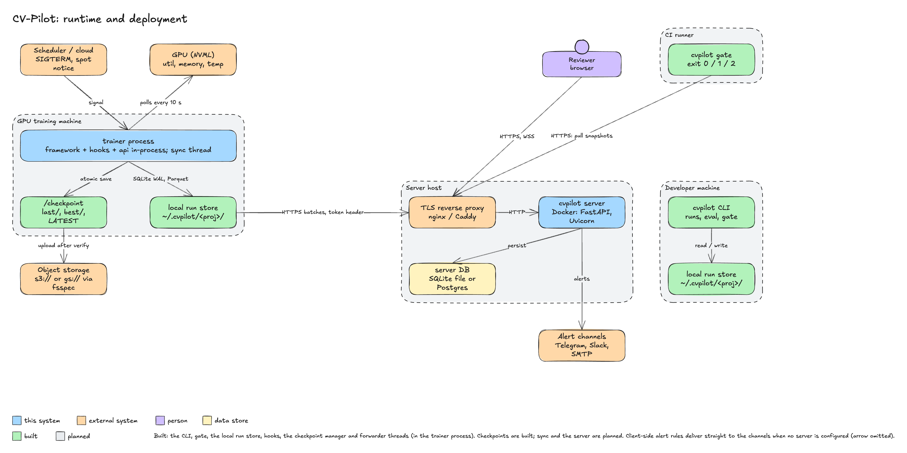

# 05 Runtime

## Process model

| Where | What runs | Threads and subprocesses |
|---|---|---|
| Training process (built: `api.py`, `runs/`, `eval/`, `ckpt/`, hooks, forwarders, store and capture in-process; planned: alerts) | the framework, the hook adapter, `api.py`, `runs/`, `eval/`, `ckpt/`, client-side `alerts/`, forwarders | main thread: training and the hook callbacks; `cvpilot-forward-<name>` daemon thread per forwarder (built); `cvpilot-sync` daemon thread: outbox → HTTPS; `cvpilot-nvml` daemon thread: NVML sample every 10 s; `cvpilot-spot-poll` daemon thread (built, off by default): asks the instance metadata service for a preemption notice, at most once per second per source, retries a failing service with backoff and logs it, and says why it stopped; signal handlers for SIGTERM/SIGUSR1 set a flag only (built). No subprocess except `git` once at `init`. |
| `cvpilot` CLI (built: `--version`, `doctor`, `runs`, `repro`, `eval`, `baseline`, `compare`, `gate`, `ckpt`) | one command per invocation, single-threaded except `eval`, whose bootstrap uses up to 4 worker threads | none; `compare` and `gate` do no resampling (they read the intervals stored in the snapshots), so they use no thread pool |
| Server container (planned) | Uvicorn with one FastAPI worker per CPU, websocket broadcaster, alert delivery worker | each worker is a process; alert delivery is an asyncio task; SQLite requires one worker, Postgres allows several |
| CI runner (built) | `cvpilot gate` as a step, or the composite action `action.yml` that wraps it; the exit code gates the job | same as CLI; the action starts one `bash` |

The hook never blocks training on I/O: `log()` appends to an in-memory buffer bounded at
10 000 points; the store flush happens on the caller's thread when the buffer is full or 2 s
have passed since the last flush, checked on each `log()` call (one Parquet write, tens of
milliseconds, built; a failed write keeps the points and raises `StoreError`); forwarders are called after the flush and their failures are logged,
not raised; forwarders run on their own daemon threads behind bounded queues (`runs/forwarding.py`, ADR-0008) and own all tracker network I/O; the sync thread, when it exists, owns the server I/O.

## Deployment nodes

| Node | Runs | Reads | Writes |
|---|---|---|---|
| Developer machine | `cvpilot` CLI (built), Python API in notebooks (planned) | local run store, checkpoint dirs, optional server over HTTPS | local run store, reports |
| GPU training machine (spot, SLURM node, workstation) | training process with hooks, sync thread, NVML sampler, checkpoint manager | dataset, DataCopilot `manifest.json`, NVML, preemption metadata endpoint | local run store, `/checkpoint`, object storage (via fsspec), tracker, server (via sync), channels (client-side alerts) |
| CI runner | `cvpilot gate`, `cvpilot compare --report`, or the composite action `action.yml` (built) | project store (checked-out copy or mounted bucket) or server snapshots over HTTPS | report artifact uploaded by the CI job |
| Object storage (S3, GCS, any fsspec backend) | nothing | — | checkpoint mirror (`<remote>/<run_id>/{last,best}/...`), exported artifacts |
| Server host (optional) | `cvpilot-server` Docker image behind a TLS reverse proxy; SQLite file volume or Postgres | ingest from sync clients, snapshots for CI and browsers | server DB, alert deliveries, share links |
| Notification channels | Telegram Bot API, Slack, webhook endpoints, SMTP relay | — | — |

## Storage locations and defaults

| Data | Default location | Override | Notes |
|---|---|---|---|
| Run store (built) | `$HOME/.cvpilot/<project>/` | `CVPILOT_STORE_DIR` or `init(store_dir=...)` | layout in [03-data-model.md](03-data-model.md); one directory per project |
| Checkpoints (built) | `CheckpointManager(dir=...)`, no default | `CVPILOT_CHECKPOINT_DIR` | a mounted bucket path on SkyPilot; one directory per run, mode 0700 |
| Checkpoint mirror (built) | none | `CheckpointManager(remote=...)` or `CVPILOT_CHECKPOINT_REMOTE` | `s3://`, `gs://`, `az://` URL without credentials, query or user info; credentials come from the backend's own environment |
| Compare reports | the `--report` and `--report-json` paths only; nothing is written to the store | `--report`, `--report-json` | static HTML (no script, strict CSP), at most 8 MiB; the prediction-diff gallery is planned |
| Server database | `/data/cvpilot.sqlite` inside the container | `CVPILOT_SERVER_DATABASE_URL` | `sqlite:///...` or `postgresql://...` |
| Logs | `stderr` | none | collected by the process supervisor or container runtime |

## Configuration

All configuration is environment variables with the `CVPILOT_` prefix, read once at process
start by `settings.py`; an invalid value is reported on `stderr` with exit 2 before logging
is configured. Precedence, highest first: explicit function argument or CLI option; environment
variable; default. There is no configuration file.

| Variable | Type / values | Default | Used by | Status |
|---|---|---|---|---|
| `CVPILOT_ENV` | `dev`, `staging`, `prod` | `prod` | logging (`env` field, DEBUG only in `dev`) | built |
| `CVPILOT_LOG_LEVEL` | `DEBUG`, `INFO`, `WARNING`, `ERROR` | `INFO` | logging | built |
| `CVPILOT_PROJECT` | project name `[a-z0-9][a-z0-9_-]{0,63}` | none | `init()` and CLI commands when the project is omitted | built |
| `CVPILOT_STORE_DIR` | directory path, expanded and resolved; not a file or `/` | `$HOME/.cvpilot` | store, CLI | built |
| `CVPILOT_STORE_COMMAND_LINE` | `true`, `false` (also `1/0`, `yes/no`, `on/off`) | `true` | `Repro.command_line` capture; `false` stores only the executable name and the argument count | built (`settings.py` parses it; `api.init` passes it to `capture_repro`; tests cover both values) |
| `CVPILOT_SERVER_URL` | `https://host[:port]` | none (sync disabled) | sync client, `gate --from-server` | planned |
| `CVPILOT_TOKEN` | per-project token | none | sync client, CLI calls to the server; sent as `Authorization: Bearer` | planned, secret |
| `CVPILOT_CHECKPOINT_DIR` | directory path | none | `CheckpointManager` default `dir`, `resume_path`, CLI | built |
| `CVPILOT_CHECKPOINT_REMOTE` | `s3://`, `gs://` or `az://` URL (no credentials) | none | `CheckpointManager` default `remote` | built |
| `CVPILOT_CKPT_KEY` | secret, 32 to 1024 bytes (for example `openssl rand -hex 32`) | none (no tags) | HMAC tags on manifests and pointers; verified on restore; never logged or stored | built, secret |
| `CVPILOT_CKPT_REQUIRE_TRUST` | `any`, `anchored`, `authenticated` | `any` | minimum trust level a restore accepts; `authenticated` needs `CVPILOT_CKPT_KEY`; recommended for any shared or bucket-backed directory | built |
| `CVPILOT_CKPT_ALLOW_PT` | `true`, `false` (also `1/0`) | `false` | allows the pickle-based `pt` checkpoint format (needs the framework at 2.6 or newer) | built |
| `CVPILOT_FORWARD_TO` | comma-separated forwarder names `[a-z][a-z0-9_-]{0,31}`, at most 8, no repeats | empty | `init()` default `forward_to`; an unknown name or a missing extra fails `init()` before a run exists | built (`settings.py` parses it, `init` passes it to the fan-out; tests run it through the real `init` path) |
| `CVPILOT_FORWARD_HOSTS` | comma-separated lower-case host names (no wildcards), at most 32 | empty (no restriction) | forwarders: only these hosts may be tracker endpoints; Trackio refuses to run with it set | built (parsed in `settings.py`, passed to every adapter by `init`; tests cover the real path) |
| `RANK`, `LOCAL_RANK` | integers set by a distributed launcher | unset | `init`: a non-zero value starts no forwarder (`forward_skipped_rank`) | built |
| `CVPILOT_ALERT_CHANNELS` | comma-separated channel names | empty | client-side alert delivery | planned |
| `CVPILOT_SERVER_DATABASE_URL` | SQLAlchemy URL | `sqlite:////data/cvpilot.sqlite` | server only | planned |
| `CVPILOT_SERVER_TOKEN_HASHES` | path to a file of `project:sha256(token)` lines | `/data/tokens` | server only | planned |
| `CVPILOT_TELEGRAM_BOT_TOKEN`, `CVPILOT_TELEGRAM_CHAT_ID` | string | none | Telegram channel | planned, secret |
| `CVPILOT_SLACK_WEBHOOK_URL`, `CVPILOT_WEBHOOK_URL` | URL | none | Slack and generic webhook channels | planned, secret |
| `CVPILOT_SMTP_URL` | `smtp[s]://user:pass@host:port` | none | SMTP channel | planned, secret |

## Secrets

| Secret | May live in | Must never appear in |
|---|---|---|
| `CVPILOT_TOKEN` (project token) | environment of the training process and CI (CI secret store), the `Authorization` header over TLS | logs, `Repro.command_line`, `Repro.config`, reports, the run store, URLs, `doctor` output |
| Server token hashes | the file named by `CVPILOT_SERVER_TOKEN_HASHES` (SHA-256 of the token only) | the server database in clear text, logs, HTTP responses |
| Telegram bot token, Slack and webhook URLs, SMTP URL | environment of the process that delivers alerts (server, or training process for client-side delivery) | logs, alert messages, share links, the run store |
| Tracker credentials (`MLFLOW_TRACKING_TOKEN`, `WANDB_API_KEY`, the tracker's own variables) | the training process's environment, read by the tracker SDK only | CV-Pilot configuration, logs (exception text of an adapter is never logged, only its type), the run store, URLs |
| Cloud credentials for fsspec | the backend's own mechanism (instance role, `AWS_*`, `GOOGLE_APPLICATION_CREDENTIALS`) | CV-Pilot configuration, logs, manifests |
| Share links | server database (random 32-byte token, expiry ≤ 7 days) | logs |

Key-based redaction in `logging.py` already covers keys ending in `token`, `password`,
`api_key`, `jwt`, `authorization`. The alerts package adds the suffixes `webhook_url`,
`smtp_url` and `chat_id` to the redaction list before any channel is registered. Free-text
fields are never used for secrets.

## Optional extras

| Extra | Unlocks | Dependencies added | Hardware |
|---|---|---|---|
| `cvpilot[lightning]` | Lightning logger and callback hook (`autolog(trainer, ...)`) | `lightning` (brings `torch`) | GPU recommended for training; CPU works for tests |
| `cvpilot[safetensors]` | save and load checkpoints (the default format) | `safetensors` | none |
| `cvpilot[remote-s3]`, `cvpilot[remote-gcs]`, `cvpilot[remote-azure]` | checkpoint mirror to object storage for that scheme | `fsspec` and `s3fs`, `gcsfs` or `adlfs` | none |
| `cvpilot[remote]` | the `fsspec` library only, for a backend you install yourself | `fsspec` | none |
| `cvpilot[mlflow]`, `cvpilot[wandb]`, `cvpilot[trackio]` | forwarder to that tracker (`init(forward_to=["mlflow"])`) | `mlflow-skinny`, `wandb`, `trackio` | none |
| `cvpilot[ultralytics]` | Ultralytics callbacks (`autolog(YOLO(...))`), scalars and per-class AP; `resume_arguments(point)` for the `resume=` target of a verified `pt` file (confusion capture is planned) | `ultralytics` (AGPL-3.0, brings `torch`) | GPU recommended |

Planned, and deliberately not published as extras until they install something: the Hugging Face
and MMEngine hooks, the alert channels (`httpx`) and the server (`fastapi`, `uvicorn`, `sqlalchemy`,
`asyncpg`). A test fails if a published extra is empty or if the documentation tells you to install
an extra that does not exist.

Notice for `cvpilot[ultralytics]`: `ultralytics` is AGPL-3.0. It is imported only inside
`hooks/ultralytics.py`, and that module does not import it at all: the hook receives the model
through `add_callback`. No Ultralytics code is vendored. Installing and using this extra makes
the user's combined work subject to AGPL-3.0; the notice is repeated in the hook docstring and
in the `license_notice` field of the `hook_attached` event that `autolog` logs. The core package and every other extra
stay Apache-2.0.

The eval engine runs on CPU with the core package (`numpy`, `pyarrow`; `pycocotools` only for
parity tests); checkpoints need the optional `safetensors` (`cvpilot[safetensors]`), the mirror `fsspec` (`cvpilot[remote]`); verifying a checkpoint (size, structure, SHA-256, chain) needs neither. The framework
is needed only for the opt-in `pt` format and is never imported on the safetensors path.
GPU telemetry requires an NVIDIA driver and `pynvml`; without them the sampler logs
`nvml_unavailable` once at `INFO` and stays idle.
