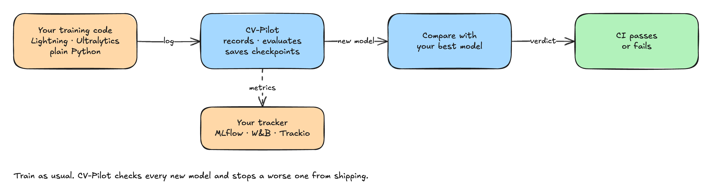

# CV-Pilot

CV-Pilot stops you from shipping a worse vision model and from losing training progress. It works
next to the experiment tracker you already use (MLflow, Weights & Biases, Trackio): it records each
training run, measures detection and classification quality per class, compares every new model
with your current best, and fails your CI build if something got worse.

It also saves crash-proof checkpoints, so a preempted or killed job resumes where it stopped.
Everything runs on your machine from Python or the command line; no server is needed.

## I want to try it

- [Install](guide/install.md) it with `pip install cvpilot` (Python 3.10 or newer).
- Follow the [Tutorial](tutorial.md): a synthetic run from logging to a failed gate to a resume.
  Every command in it is executed by a test.
- Look up a command in the [command line reference](reference/cli.md) or a function in the
  [Python API](reference/api.md).

## I want to understand it

- [Concepts](guide/concepts.md): runs, snapshots, baselines, gates and checkpoints in plain words.
- [How it works](architecture/README.md): the architecture, from a 30-second picture to the details.
- [Checkpoints and resume](guide/checkpoints.md) and the [Trust model](guide/trust.md).
- [Compare and gate in CI](guide/gating-ci.md), including the GitHub Action.
- [Settings and exit codes](reference/settings.md) and
  [what is built and what is planned](status.md).

## I want to contribute

- [Contributing](https://github.com/B4teShai/CV-Pilot/blob/main/CONTRIBUTING.md): how to send a change.
- [Engineering guide](engineering/README.md): standards, testing, errors and logging, release.
- [Architecture decisions](adr/0001-scope-and-license.md): why it is built the way it is.

## License

Apache-2.0. The optional `cvpilot[ultralytics]` extra uses the AGPL-3.0 Ultralytics package, which
then applies to your combined work.
